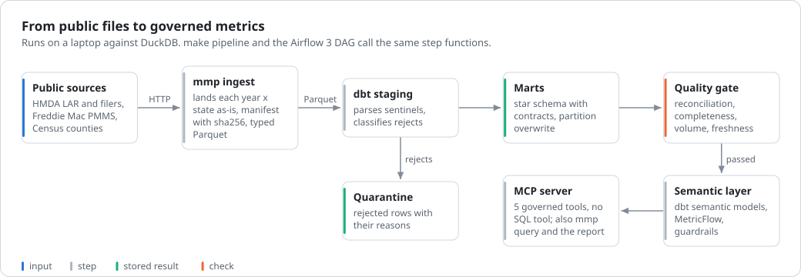
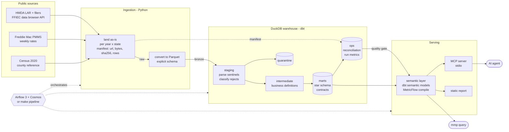
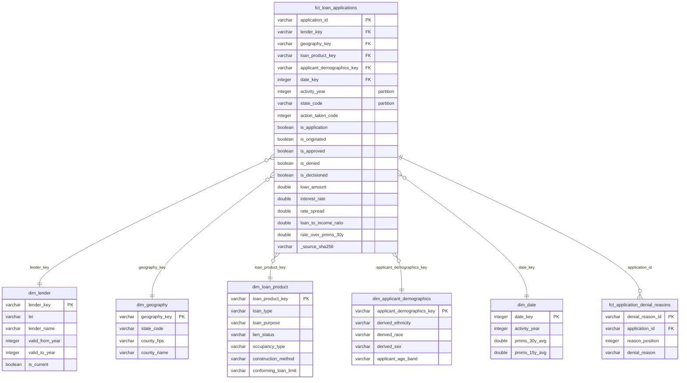
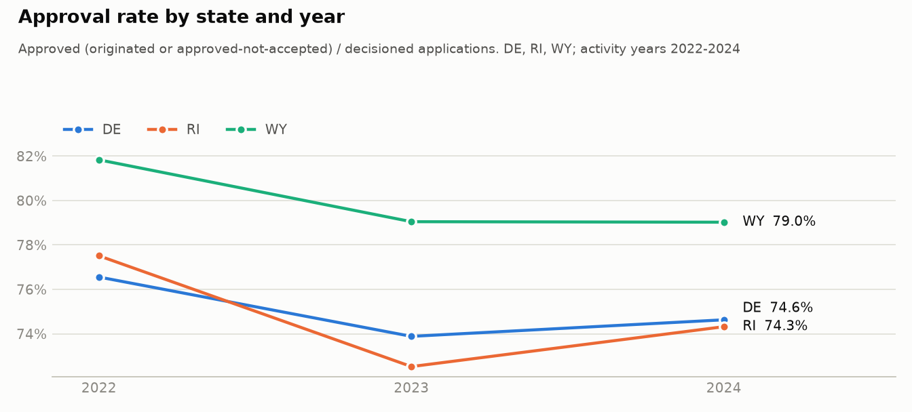
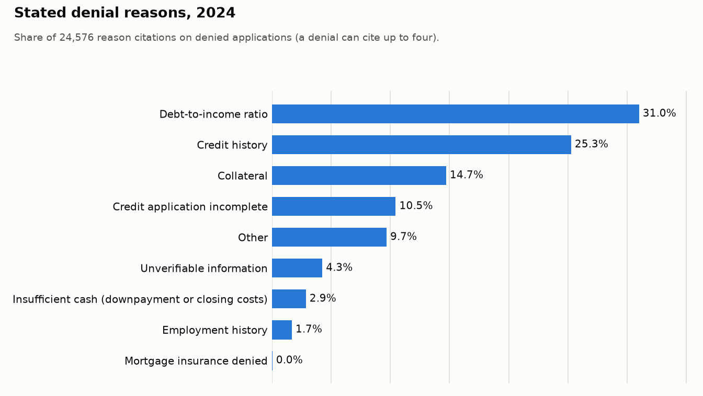
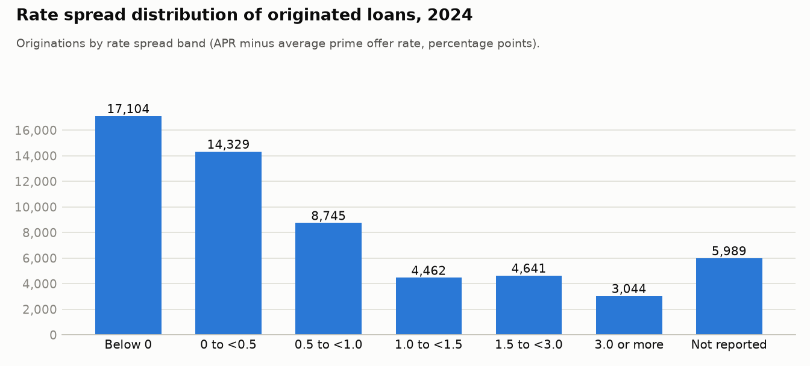
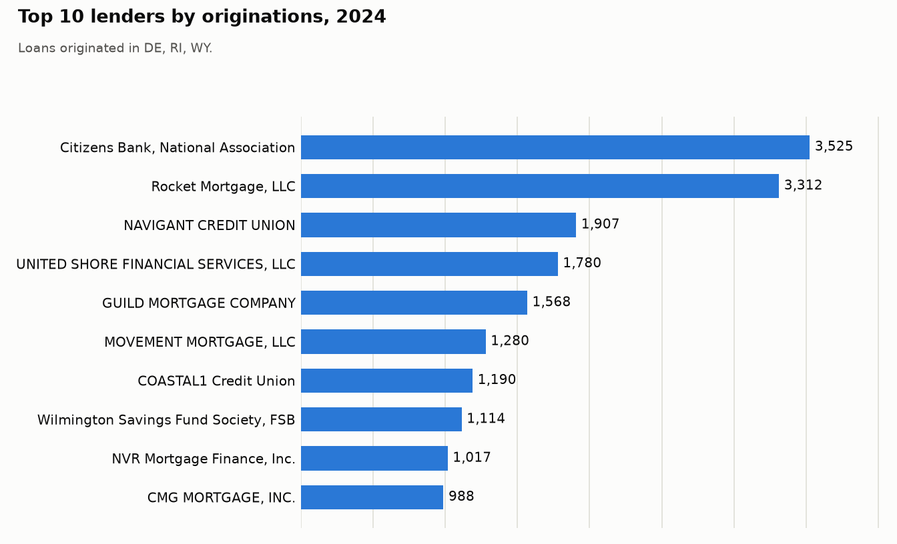
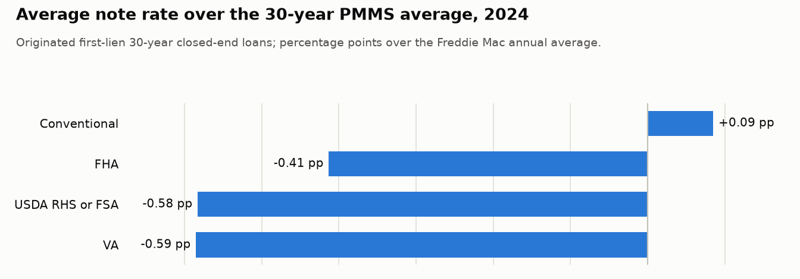
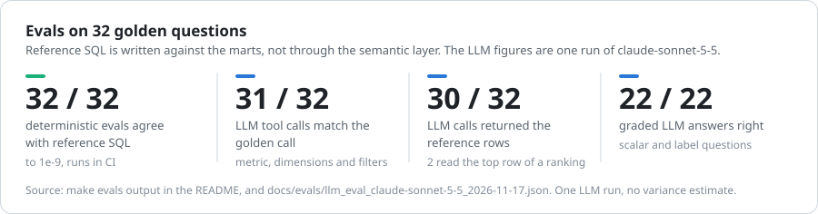
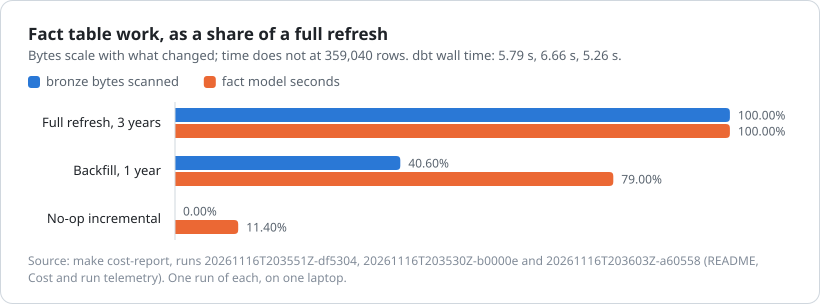

# mortgage-metrics-platform

A batch analytics platform over real US mortgage application data (the HMDA
Loan Application Register), ending in a governed semantic layer that people
and AI agents query through the same definitions.

It is a portfolio project. It runs on a laptop against DuckDB, on public data,
and has never been deployed anywhere. Every number in this README was produced
by a run on 17 November 2026 local time on the machine that built it (Apple
silicon, macOS, Python 3.12; run ids are UTC, so they read 20261116). The
command that reproduces each number is next to it.

## The problem

Mortgage analytics teams answer the same questions repeatedly (approval rates,
denial reasons, pricing against the market) and get different answers,
because each dashboard and notebook re-derives "approval rate" from raw action
codes. Giving an AI agent a SQL connection makes that worse: it will produce a
number for anything, with a definition nobody reviewed.

This repository is the plumbing that prevents it:

- an ingestion layer that is idempotent, resumable and reconciled to the byte;
- a dbt star schema with enforced contracts and incremental loads that are safe
  to re-run and to backfill out of order;
- metrics defined once, in dbt semantic models compiled by MetricFlow;
- an MCP server through which agents can query those metrics and nothing else;
- evals that check the whole path against independently written SQL;
- run telemetry that treats time and bytes as things to measure.

## What the data is, and is not

HMDA LAR is the loan-level file US lenders report under the Home Mortgage
Disclosure Act, published by the CFPB for the FFIEC. Public domain.

- It is **applications and originations**: who applied for what, where, the
  outcome, and the price of loans that closed.
- It is **not performance or servicing data**. Nothing about payments,
  delinquency or losses.
- The public file has no loan identifier and no dates, only the activity year.
  Amounts are banded. Many pricing fields are `NA` or `Exempt` for some filers.

Sources, endpoints and field conventions: [docs/data-dictionary.md](docs/data-dictionary.md).

### Responsible use of the demographic fields

HMDA collects ethnicity, race, sex and age so that lending patterns can be
monitored; that is the purpose of the dataset and why those fields are
modelled here. Public HMDA does not contain credit scores or the other inputs
to an underwriting decision. A gap between groups in this data is a reason to
look further, not evidence of discrimination. The serving layer withholds
values for demographic cells under 10 records and attaches that caveat to
every demographic breakdown. Do not use this data to make decisions about
individuals or join it to anything that could re-identify them.

## Architecture

<picture>
  <source media="(prefers-color-scheme: dark)" srcset="docs/img/architecture-dark.svg">
  
</picture>

<details>
<summary>The same diagram as text, with more detail</summary>



</details>

The same step functions are run by `make pipeline` and by the Airflow DAG.

### Star schema



`fct_loan_applications` is at the grain of one LAR record. `dim_lender` is
Type 2 on the lender name. `dim_date` is at year grain because the public LAR
has no dates. Details: [docs/data-dictionary.md](docs/data-dictionary.md).

## Quickstart

Needs [uv](https://docs.astral.sh/uv/) and nothing else. No Docker, no accounts.

```bash
git clone <this repo> && cd mortgage-metrics-platform
make setup        # uv sync, Python 3.12
make pipeline     # download, convert, dbt build, quality gate, publish, report
```

`make pipeline` downloads six HMDA partitions (Delaware, Rhode Island, Wyoming
for 2023 and 2024), their filer lists and the two reference files, 81.6 MB in
all, and runs every step.
From an empty directory it took **54.8 seconds** here, 40.6 of them downloading:

```text
run 20261116T203345Z-52e21c  kind=full_refresh  scope=demo  years=[2023, 2024]  states=['DE', 'RI', 'WY']  source=http

== ingest: land raw files, write manifests, convert to bronze Parquet
  2023/DE  downloaded    16,925,399 bytes    44,128 rows  sha256 72ac213f1234
  2023/RI  downloaded    14,576,170 bytes    38,473 rows  sha256 cc0bd55b22cd
  2023/WY  downloaded     7,182,708 bytes    18,881 rows  sha256 140d8cf436ae
  2024/DE  downloaded    18,605,360 bytes    48,786 rows  sha256 305649ebe25d
  2024/RI  downloaded    15,814,057 bytes    41,977 rows  sha256 c12e37f8820c
  2024/WY  downloaded     8,003,144 bytes    21,228 rows  sha256 801572a2253d
  reference: pmms 2,903 rows, census_counties 3,235 rows
  manifest index: 14 files
...
dbt build: {'success': 28, 'pass': 96, 'warn': 1, 'no-op': 3} in 6.7s

== data quality gate
quality gate: passed
  PASS  partition_completeness  6 expected partitions present
  PASS  reconciliation          6 partitions balanced across all hops
  PASS  quarantine_rate         0 of 213473 rows quarantined (0.000%)
  PASS  volume_anomaly          no year-over-year change beyond 40%
  PASS  freshness               newest LAR file fetched 0.00 days ago (oldest 2026-11-17)
  WARN  dbt_results             128 nodes: 0 failed, 1 warned
...
pipeline finished in 54.0s (run 20261116T203345Z-52e21c)
```

Then:

```bash
uv run mmp query approval_rate -d state_code --grain year    # a governed metric
make evals            # golden questions vs independent SQL
make mcp-smoke        # start the MCP server, call every tool over stdio
make backfill-proof   # load 2022 twice, compare checksums
make cost-report      # time and bytes per run, model, partition
make test lint        # pytest, ruff, sqlfluff
open data/published/report/index.html
```

Other scopes are in [config/pipeline.yml](config/pipeline.yml). `MMP_SCOPE=full`
lists every state for three years; it has not been run as part of this build.

## What you get

**A warehouse.** 213,473 LAR records for the demo scope; 359,040 records from
1,256 lenders after the 2022 backfill below. A star schema with enforced
contracts. `dbt build` runs 24 models, 2 seeds, 1 snapshot, 87 data tests and
10 unit tests.

The one warning on the demo scope is deliberate: 6 records report a
loan-to-value ratio above 1000%. Real HMDA has reporting errors like this; they
are surfaced by a warn-level test and left in the data.

**A metric you can ask for by name.**

```bash
$ uv run mmp query approval_rate -d state_code --grain year
```

| activity_year | state_code | approval_rate |
|---|---|---|
| 2022 | DE | 0.7655 |
| 2022 | RI | 0.7751 |
| 2022 | WY | 0.8183 |
| 2023 | DE | 0.7388 |
| 2023 | RI | 0.7252 |
| 2023 | WY | 0.7905 |
| 2024 | DE | 0.7463 |
| 2024 | RI | 0.7432 |
| 2024 | WY | 0.7902 |

(Rounded here to four places; taken after the 2022 backfill.) Add `--explain`
to see the SQL MetricFlow compiled.

**A report**, [docs/report/index.html](docs/report/index.html), five charts,
each one a metric query through the semantic layer with its data table
underneath. Generated by `make report` from the three loaded years:











## Metric catalogue

Defined once in [dbt/models/semantic/_metrics.yml](dbt/models/semantic/_metrics.yml).
This table is the output of `make catalog`.

| Metric | Type | Unit | Definition |
|---|---|---|---|
| `application_count` | simple | count | Number of applications and preapproval requests. Purchased loans (action 6) are excluded because they were not applications to the reporting lender. |
| `approval_count` | simple | count | Applications approved - originated, or approved but not accepted (actions 1, 2). |
| `approval_rate` | ratio | ratio | Approvals divided by decisioned applications: (actions 1 + 2) / (actions 1 + 2 + 3). Withdrawn, incomplete, purchased and preapproval records are in neither side. `approval_count / decisioned_application_count`. |
| `avg_interest_rate` | simple | percent | Mean note rate of originated loans that reported a rate, in percent. Exempt and not-applicable records are excluded. |
| `avg_loan_amount` | simple | usd | Mean loan amount of originated loans, in dollars. |
| `avg_rate_over_pmms_30y` | simple | percentage_points | Mean of note rate minus the activity year's average Freddie Mac 30-year PMMS rate, for originated first-lien 360-month closed-end loans, in percentage points. The benchmark is an annual average because the public LAR has no dates. |
| `avg_rate_spread` | simple | percentage_points | Mean rate spread (APR minus average prime offer rate) of originated loans that reported one, in percentage points. Sensitive to a few extreme reported values; see median_rate_spread. |
| `decisioned_application_count` | simple | count | Applications the lender decided - originated, approved but not accepted, or denied (actions 1, 2, 3). |
| `denial_count` | simple | count | Number of applications denied (action 3). Preapproval denials are not included. |
| `denial_rate` | ratio | ratio | Denials divided by decisioned applications - action 3 / (actions 1 + 2 + 3). Equals 1 - approval_rate. `denial_count / decisioned_application_count`. |
| `denial_reason_citations` | simple | count | Number of times a denial reason was cited. Group by denial_reason for the reason mix. A denial citing several reasons is counted once per reason, so the total exceeds denial_count. |
| `lar_record_count` | simple | count | All reported LAR records, including purchased loans. Use for volume reconciliation, not for rates. |
| `median_loan_amount` | simple | usd | Median loan amount of originated loans, in dollars. Prefer this to the mean; the amount distribution has a long right tail. |
| `median_loan_to_income` | simple | ratio | Median of loan amount divided by annual income, over applications with reported positive income. |
| `median_rate_spread` | simple | percentage_points | Median rate spread of originated loans that reported one, in percentage points. |
| `originated_loan_volume` | simple | usd | Sum of loan amounts of originated loans, in dollars. Amounts are published as $10,000-band midpoints. |
| `origination_count` | simple | count | Number of loans originated (action 1). |
| `origination_rate` | ratio | ratio | Originations divided by applications (pull-through). Purchased loans are excluded from both sides. `origination_count / application_count`. |
| `withdrawn_or_incomplete_count` | simple | count | Applications withdrawn by the applicant or closed for incompleteness (actions 4, 5). |

Dimensions (availability per metric comes from MetricFlow's join graph; ask
`describe_metric`): `activity_year`, `state_code`, `county_name`, `county_fips`,
`lender_name`, `lei`, `loan_type`, `loan_purpose`, `lien_status`,
`occupancy_type`, `construction_method`, `conforming_loan_limit`,
`action_taken`, `primary_denial_reason`, `denial_reason`, `debt_to_income_band`,
`rate_spread_band`, and the demographic dimensions `derived_race`,
`derived_ethnicity`, `derived_sex`, `applicant_age_band`.

Allowed grains: `total` and `year`. The public LAR has no finer time attribute.

## The agent interface

`mmp-mcp` is an MCP server (official `mcp` Python SDK 2.3, stdio transport).

| Tool | What it does |
|---|---|
| `list_metrics` | The catalogue: name, label, unit, definition |
| `describe_metric(metric)` | Formula, allowed dimensions and grains, filter operators, limits |
| `list_dimension_values(metric, dimension)` | Exact labels to filter on, with record counts |
| `query_metric(metric, dimensions, filters, grain, limit, order_by)` | One governed metric, grouped and filtered; returns rows, unit, notes and the compiled SQL |
| `get_lineage(metric)` | Measures and their expressions, the dbt model, every upstream model, seed and source |

There is no tool that takes SQL. A request goes through one path:

```text
request -> guardrails -> MetricFlow compile -> SQL -> read-only DuckDB (15 s timeout) -> rows -> audit log
```

Guardrails ([src/mmp/semantic/guardrails.py](src/mmp/semantic/guardrails.py)):

| Rule | Enforcement |
|---|---|
| Only governed metrics | metric must be in the catalogue built from the dbt semantic manifest |
| Dimension allow-list | per metric, from MetricFlow; at most 4 per query |
| Structured filters only | `{dimension, op, value}`; operators `=, !=, in, not_in`, plus `<, <=, >, >=` on `activity_year`; at most 8 |
| Filter values are data | type and length checked, rendered as escaped literals inside MetricFlow filter templates |
| Row limits | default 100, maximum 1000, truncation reported in the result |
| Timeout | query cancelled after 15 seconds |
| Read-only | the serving connection cannot write; the MetricFlow client in the process can compile but not execute |
| Small cells | demographic breakdowns withhold values for cells under 10 records |
| Audit | every call, including refusals, appended to `data/logs/mcp_audit.jsonl` |

Refusals come back as tool errors the model can read and act on:

```text
Error executing tool query_metric: Request rejected: limit 100000 exceeds the maximum of 1000 rows
```

### Connecting a client

Claude Desktop (`claude_desktop_config.json`) or any client that takes the
same shape:

```json
{
  "mcpServers": {
    "mortgage-metrics": {
      "command": "uv",
      "args": ["run", "--directory", "/absolute/path/to/mortgage-metrics-platform", "mmp-mcp"]
    }
  }
}
```

Claude Code:

```bash
claude mcp add mortgage-metrics -- uv run --directory /absolute/path/to/mortgage-metrics-platform mmp-mcp
```

Run `make pipeline` first; the server reads the warehouse it built. The launch
command above was checked with a Python MCP client. It was not tried inside
Claude Desktop or Claude Code.

`make mcp-smoke` starts the server as a subprocess and drives it through a real
client session:

```text
connected to mortgage-metrics 0.1.0
  ok    tools/list: ['describe_metric', 'get_lineage', 'list_dimension_values', 'list_metrics', 'query_metric']
  ok    no SQL tool: no tool name mentions sql
  ok    list_metrics: 19 metrics
  ok    describe_metric: formula=approval_count / decisioned_application_count, 20 dimensions, grains=['total', 'year']
  ok    list_dimension_values: ['Home purchase', 'Cash-out refinancing', 'Refinancing', 'Home improvement', 'Other purpose', 'Not applicable']
  ok    query_metric: 9 rows, first={'activity_year': 2022, 'state_code': 'DE', 'approval_rate': 0.8645559770450345}
  ok    get_lineage: measures=['approvals', 'decisioned_applications'], upstream nodes=14
  ok    reject unknown dimension: Error executing tool query_metric: Request rejected: dimension(s) ['ssn'] are not allowed ...
  ok    reject oversized limit: Error executing tool query_metric: Request rejected: limit 100000 exceeds the maximum of 1000 rows
  ok    filter value is data, not SQL: rows=[{'application_count': None}]
  ok    reject unknown operator: Error executing tool query_metric: Request rejected: filter operator 'like' is not allowed ...
  ok    reject unknown metric: Error executing tool query_metric: Request rejected: unknown metric 'select * from marts.fct_loan_applications ...
MCP smoke test: all checks passed
```

(The `query_metric` row is home purchase applications only, which is why it
differs from the table above.)

## Evals

[evals/golden_questions.yml](evals/golden_questions.yml) has 32 questions. Each
has the question as a person would ask it, the `query_metric` call a correct
agent should arrive at, and reference SQL written directly against the marts
that does not use the semantic layer or its `is_*` flags.

<picture>
  <source media="(prefers-color-scheme: dark)" srcset="docs/img/evals-dark.svg">
  
</picture>

**Layer 1, deterministic. Runs in CI, no API key.** Execute the expected call
through the same toolbox the MCP server uses, run the reference SQL, require
agreement to 1e-9.

```text
$ make evals
  PASS  q01  approval_rate                  1 rows match
  PASS  q02  denial_rate                    1 rows match
  ...
  PASS  q31  denial_rate                    8 rows match
  PASS  q32  denial_reason_citations        1 rows match
deterministic evals: 32/32 passed; 17 metrics covered; not covered: ['approval_count', 'decisioned_application_count']
```

The two uncovered metrics are the numerator and denominator of `approval_rate`
and are exercised through it. The answers on the demo data are saved in
[evals/golden_answers.demo.json](evals/golden_answers.demo.json), for example
q01 "What was the mortgage approval rate in Delaware in 2024?" is 0.746283
from both paths. A test feeds the eval a deliberately wrong reference to check
that it fails when it should.

**Layer 2, LLM. Optional.** [src/mmp/evals/llm_runner.py](src/mmp/evals/llm_runner.py)
gives a model (`claude-sonnet-5-5` by default) the MCP tools over a real stdio
session and scores three things per question: whether a `query_metric` call
matched the expected metric, dimensions and filters; whether any call returned
the reference rows; and whether the submitted answer is right.

Run on 17 November 2026 with `claude-sonnet-5-5`, all 32 questions, through the
real MCP stdio server (`make eval-llm`):

| Measure | Score |
| --- | --- |
| Questions completed | 32 / 32 |
| Tool selection (same metric, dimensions and filters as the golden call) | 31 / 32 (0.9688) |
| Result (rows returned equal the reference rows) | 30 / 32 (0.9375) |
| Answer (submitted value or label is right) | 22 / 22 graded scalar and label questions (1.0) |
| Tokens in / out | 390,374 / 11,386 |

The three marks lost, none of which produced a wrong answer:

- **q10** (median rate spread on originated FHA loans, 2024): the model added an
  `action_taken = Loan originated` filter that the golden call does not have.
  Rows and answer matched.
- **q13** (most cited denial reason, RI 2024) and **q21** (Delaware county with
  the most originations, 2024): the model fetched the ranked breakdown and read
  the top row itself, so the rows returned were not the reference rows. The
  submitted label and value were right in both.

This is one run of one model. It was not repeated, so there is no variance
estimate, and 32 questions over three small states is a small set. The full
per-question output, including every tool call, is in
[docs/evals/llm_eval_claude-sonnet-5-5_2026-11-17.json](docs/evals/llm_eval_claude-sonnet-5-5_2026-11-17.json).

To run it:

```bash
export ANTHROPIC_API_KEY=...
make eval-llm                              # all 32 questions
uv run --extra llm mmp eval-llm --limit 5  # a few
```

Refusal fallbacks to another model are deliberately off, so a score describes
one model.

## Incremental loads, backfill and idempotency

HMDA arrives as one file per (year, state) with no row identifier, so the unit
of loading is the partition: replaced whole, or left alone
([ADR 0002](docs/adr/0002-partition-overwrite-by-source-hash.md)). A partition
is loaded when its source file hash changes or when a run asks for its year.

Second `make pipeline` with nothing new, 11.2 seconds: every file is a cache
hit and the incremental models write zero rows.

`make backfill-proof` then loads 2022 (a year older than what is already
there), loads it again, and compares content checksums (an order-independent
hash over every business column) of every mart table:

```text
== backfill, run 1
run 20261116T203458Z-6ca876  kind=backfill  scope=demo  years=[2022]  states=['DE', 'RI', 'WY']  source=http
  2022/DE  downloaded    23,662,513 bytes    62,038 rows  sha256 87d85599f609
  2022/RI  downloaded    21,363,640 bytes    56,604 rows  sha256 9b70262b84c6
  2022/WY  downloaded    10,207,945 bytes    26,925 rows  sha256 a133b3076a8e
dbt build: {'success': 28, 'pass': 95, 'warn': 2, 'no-op': 3} in 5.9s
quality gate: passed
pipeline finished in 31.9s (run 20261116T203458Z-6ca876)

== backfill, run 2 (same years again)
run 20261116T203530Z-b0000e  kind=backfill  scope=demo  years=[2022]  states=['DE', 'RI', 'WY']  source=http
  2022/DE  cached        23,662,513 bytes    62,038 rows  sha256 87d85599f609
  2022/RI  cached        21,363,640 bytes    56,604 rows  sha256 9b70262b84c6
  2022/WY  cached        10,207,945 bytes    26,925 rows  sha256 a133b3076a8e
dbt build: {'success': 28, 'pass': 95, 'warn': 2, 'no-op': 3} in 6.7s
quality gate: passed
pipeline finished in 11.1s (run 20261116T203530Z-b0000e)

== fact partitions after run 1 and run 2 (table, partition, rows, checksum)
marts.fct_loan_applications            2022/DE     62,038 ac5dc46807f468ce| 62,038 ac5dc46807f468ce
marts.fct_loan_applications            2022/RI     56,604 5ebae55fb52f6a82| 56,604 5ebae55fb52f6a82
marts.fct_loan_applications            2022/WY     26,925 b8a2381ef14f95cb| 26,925 b8a2381ef14f95cb
marts.fct_loan_applications            2023/DE     44,128 91f11566cc1eac51| 44,128 91f11566cc1eac51
marts.fct_loan_applications            2023/RI     38,473 3af9293aa9c8119f| 38,473 3af9293aa9c8119f
marts.fct_loan_applications            2023/WY     18,881 78c2ef3c397def11| 18,881 78c2ef3c397def11
marts.fct_loan_applications            2024/DE     48,786 2616fc71962629e0| 48,786 2616fc71962629e0
marts.fct_loan_applications            2024/RI     41,977 43d58a8b3bd8c6b0| 41,977 43d58a8b3bd8c6b0
marts.fct_loan_applications            2024/WY     21,228 02c42c2be531f1b8| 21,228 02c42c2be531f1b8

== diff of all mart checksums between run 1 and run 2
identical: 23 table/partition checksums match

== partitions that existed before the backfill are unchanged
unchanged: 12 pre-existing fact partition checksums
```

The second run rewrote the three 2022 partitions (the audit columns show a new
invocation) and produced the same content. The 2023 and 2024 partitions have
the checksums they had before the backfill started. A `--full-refresh`
afterwards reproduced the same 23 checksums.

The second dbt warning after the backfill is `warn_lender_versions_overlap`:
8 lenders went back to an earlier name between 2022 and 2024
([ADR 0004](docs/adr/0004-lender-scd2.md)).

The same properties are tested on the fixture sample in
[tests/test_pipeline.py](tests/test_pipeline.py), together with: a changed
source file replaces only its partition; corrupted rows are quarantined with
reasons and still reconcile; rows deleted behind dbt's back fail the next build.

## Data quality

Built into the pipeline rather than run beside it
([ADR 0007](docs/adr/0007-sentinels-quarantine-and-failing-closed.md)).

| Stage | Check | On failure |
|---|---|---|
| Landing | sha256 of the bytes on disk; atomic rename | partial files never get the final name |
| Conversion | header equals the declared 99 columns; typed columns parse; Parquet rows = raw line count | partition not written, run stops |
| Staging | each row gets a reject reason or none | rejected rows go to `quarantine.rejected_lar_rows` |
| Marts | dbt contracts, 87 data tests, 10 unit tests | build fails |
| Reconciliation | raw = bronze = accepted + quarantined; accepted = fact; loan amount sums and file hashes match, per partition | singular tests fail the build |
| Quality gate | completeness, reconciliation, quarantine rate under 1%, volume change under 80% year over year, freshness under 30 days, no dbt failures | exits non-zero; nothing is published |

On the real demo data nothing is quarantined (0 of 359,040 rows across three
years) and every partition reconciles. Year-over-year volume fell 29% to 32%
from 2022 to 2023 in all three states, inside the 40% warning threshold. The
quarantine and failure paths are exercised by tests, not by the real data.

## Cost and run telemetry

Every step writes a record: duration, rows in and out, bytes scanned and
written, tagged with the run and, where it applies, the partition. `make
cost-report` loads them into `ops.run_metrics` and prints the report. There is
no bill for a local file, so "cost" is the inputs to one: seconds and bytes.

The six runs of this build, in order (first build, no-op rerun, backfill of
2022, backfill again, full refresh of all three years, no-op rerun):

```text
| run_id                  | kind         | download_s | downloaded_bytes | convert_s | dbt_wall_s | dbt_model_s | dbt_test_s | fact_rows_written | fact_bytes_scanned | fact_bytes_written_est |
|-------------------------|--------------|-----------:|-----------------:|----------:|-----------:|------------:|-----------:|------------------:|-------------------:|-----------------------:|
| 20261116T203345Z-52e21c | full_refresh |      40.60 |       81,586,042 |      0.80 |       6.68 |        2.72 |       3.53 |           213,473 |          7,252,146 |             14,680,064 |
| 20261116T203447Z-d4f55a | incremental  |       0.05 |                0 |      0.01 |       5.30 |        1.92 |       2.59 |                 0 |                  0 |                      0 |
| 20261116T203458Z-6ca876 | backfill     |      20.48 |       55,372,110 |      0.53 |       5.90 |        2.44 |       2.96 |           145,567 |          4,947,271 |              9,671,668 |
| 20261116T203530Z-b0000e | backfill     |       0.03 |                0 |      0.00 |       6.66 |        2.87 |       3.90 |           145,567 |          4,947,271 |              9,671,668 |
| 20261116T203551Z-df5304 | full_refresh |       0.08 |                0 |      0.01 |       5.79 |        2.55 |       2.50 |           359,040 |         12,199,417 |             23,068,672 |
| 20261116T203603Z-a60558 | incremental  |       0.03 |                0 |      0.00 |       5.26 |        1.92 |       2.53 |                 0 |                  0 |                      0 |
```

<picture>
  <source media="(prefers-color-scheme: dark)" srcset="docs/img/incremental-vs-full-dark.svg">
  
</picture>

Incremental against full refresh, for the fact table:

```text
| kind         | run_id                  | fact_rows_written | fact_bytes_scanned | fact_model_s | all_models_s | dbt_wall_s | bytes_scanned_pct_of_full | fact_model_s_pct_of_full |
|--------------|-------------------------|------------------:|-------------------:|-------------:|-------------:|-----------:|--------------------------:|-------------------------:|
| full_refresh | 20261116T203551Z-df5304 |           359,040 |         12,199,417 |         0.75 |         2.55 |       5.79 |                    100.00 |                   100.00 |
| incremental  | 20261116T203603Z-a60558 |                 0 |                  0 |         0.09 |         1.92 |       5.26 |                      0.00 |                    11.40 |
| backfill     | 20261116T203530Z-b0000e |           145,567 |          4,947,271 |         0.59 |         2.87 |       6.66 |                     40.60 |                    79.00 |
```

How to read this honestly:

- **Bytes and rows scale with what changed.** A no-op run scans zero bronze
  bytes for the fact; backfilling one year of three scans 40.6% of what a full
  refresh does and writes 40.5% of the rows.
- **Wall time does not, at this size.** dbt takes about five seconds whatever
  it loads: start-up, 13 views, 7 small tables, and 87 tests. The fact model
  itself drops from 0.75 s to 0.09 s, which is the saving that would grow with
  data volume. At 359k rows the incremental design is not buying time; it is
  shown here because it is what the same project needs at 11 million rows a year.
- **The tests are the larger cost and they are not incremental.** Tests on the
  staging and intermediate views scan every partition on every run (2.5 to
  3.9 s, more than the models). On a pay-per-scan warehouse those are the first
  thing to restrict to the partitions a run touched.
- `bytes_scanned` is the Parquet size of the partitions a model selected, and
  `bytes_written` is the table's on-disk block size pro-rated by rows written.
  DuckDB has no bytes-billed counter. Both are labelled estimates where they are.

The report also has per-model timings and a per-partition table (download
seconds, raw bytes, Parquet bytes, times loaded, allocated model seconds).
Raw CSV to zstd Parquet is about 11:1 (23.7 MB to 2.1 MB for Delaware 2022).

## Orchestration

One DAG, [dags/hmda_mortgage_metrics.py](dags/hmda_mortgage_metrics.py), on
Apache Airflow 3.4.0 with astronomer-cosmos 1.16.0
([ADR 0006](docs/adr/0006-orchestration-airflow-3-and-cosmos.md)).

- Yearly data-interval schedule; one run loads one activity year.
- Ingestion is dynamically mapped over states.
- dbt runs through Cosmos, one task per model with its tests (72 tasks per run).
- Pools: `hmda_api` (2 slots) for downloads, `duckdb_writer` (1 slot) for
  everything that opens the warehouse.
- Retries with exponential backoff, execution timeouts, retry and failure
  callbacks on every task, a DAG failure callback, `dagrun_timeout`, and a
  `DeadlineAlert` (Airflow 3's replacement for SLAs).
- The quality gate blocks publishing; telemetry loads even when a run fails.

```bash
make test-dags     # 8 DAG integrity tests: import, cycles, schedule, default args, pools, mapping, gating
make airflow-up    # Postgres + API server + DAG processor + scheduler; memory limits total 1992 MiB
make airflow-down
```

### What was verified in Docker

The stack was built and run in Docker on the same machine (compose project
`mmp-airflow`, four containers), then removed with `docker compose down -v`.

Final sequence, all on one warehouse volume:

| Run | Activity year | Tasks | Result | Duration |
|---|---|---|---|---|
| `scheduled__2026-07-01` (created when the DAG was unpaused) | 2025 | 72 | success after one fix, see below | 147 s to the gate, 9 s to finish after the fix |
| `backfill__2023-07-01` | 2022 | 72 | success | 172 s |
| `backfill__2024-07-01` | 2023 | 72 | success | 154 s |
| `backfill__2025-07-01` | 2024 | 72 | success | 145 s |
| `backfill__2023-07-01` again, `--reprocess-behavior completed` | 2022 | 72 | success | 144 s |

The backfill for 2022 to 2024 was created with `--max-active-runs 1` and ran
one run at a time, oldest first, after the 2025 run: that is, out of order.
The 2022 files were downloaded inside the container (three cache misses, 23.7,
21.4 and 10.2 MB). The 2023 and 2024 files were copied into the volume from
the host's cache beforehand to avoid downloading them a third time, and the
2025 files had been downloaded by an earlier attempt in the container; the
ingest tasks verified their hashes and skipped the network.

Checksums recorded by the `record_checksums` task for 2022, first backfill
and re-run:

```text
marts.fct_loan_applications            2022/DE     62,038 ac5dc46807f468ce| 62,038 ac5dc46807f468ce
marts.fct_loan_applications            2022/RI     56,604 5ebae55fb52f6a82| 56,604 5ebae55fb52f6a82
marts.fct_loan_applications            2022/WY     26,925 b8a2381ef14f95cb| 26,925 b8a2381ef14f95cb
marts.fct_application_denial_reasons   2022/DE     12,499 2eaeb560b34f2cb2| 12,499 2eaeb560b34f2cb2
marts.fct_application_denial_reasons   2022/RI     11,834 74a3bd814a4feabf| 11,834 74a3bd814a4feabf
marts.fct_application_denial_reasons   2022/WY      4,053 b34c93a95994ed9d| 4,053 b34c93a95994ed9d
```

Identical. The re-run rewrote the 2022 partitions (`_loaded_at` moved from the
first run to 20:59:09 UTC) and left 2023, 2024 and 2025 as they were. The fact
checksums for 2022 to 2024 are also the same values the `make pipeline` runs
produced on macOS, from the Linux container. All 12 partitions reconciled.

A run takes about two and a half minutes under Airflow against about six
seconds of `dbt build` from the shell. That is 63 dbt tasks, each starting dbt,
through a single-slot pool.

Memory at rest after the runs: scheduler 385 MiB of 1000, API server 301 of
512, DAG processor 207 of 320, Postgres 45 of 160. The highest scheduler
readings seen during runs were 577 MiB in this configuration and 719 MiB in
an earlier one with four dbt threads. Memory was sampled a few times, not
monitored continuously.

### What went wrong on the way

Four things failed before that sequence was clean. They are listed because
each one says something about the design.

1. **Overlapping runs.** On the first attempt a scheduled run and two backfill
   runs started together despite `max_active_runs=1`. With three task
   processes in the scheduler container (880 MiB then), ingest tasks were
   killed by a signal, which Airflow reported as a likely out-of-memory kill.
   They were retried and the retry callback fired.
   Fix: parallelism 2, more memory for the scheduler, and backfills created
   with `--max-active-runs 1`. The DAG still does not enforce serial runs
   against backfills; it is an operating rule in the [runbook](docs/runbook.md#airflow).
2. **An inconsistent cache, caught.** I had copied raw files for 2023 and 2024
   into the volume without their Parquet. The 2025 run then saw six partitions
   in the manifest with nothing behind them: `assert_reconciliation_balanced`
   and `assert_fact_partitions_match_manifest` failed with six rows each, both
   were retried once, the failure callbacks and the DAG failure callback fired,
   and `quality_gate`, `publish_metrics` and `record_checksums` were never run
   (`upstream_failed`). That is the pipeline failing closed on real
   inconsistency, by accident rather than by test.
3. **DuckDB out of memory.** With four dbt threads and a 400 MB DuckDB cap,
   three tests over the staging views ran at once and failed with out-of-memory
   errors. Fix: a dbt profile target for the container with one dbt thread and
   a spill directory.
4. **A bug in the gate.** The gate insisted on a `run_results.json`, which
   Cosmos does not leave behind. The run stopped at the gate with every dbt
   task green. Fix: under Airflow the gate relies on task dependencies for
   that check. The failed task was cleared and the run finished without
   repeating the 69 tasks that had succeeded.

Not exercised in Docker: the deadline alert, a download failure with retries
against the real API, and the Airflow UI beyond the health check.

## CI/CD

[.github/workflows/ci.yml](.github/workflows/ci.yml) has five jobs. CI never
calls the HMDA API: it runs with `MMP_SCOPE=fixture` against 4,184 real LAR
rows committed under [tests/fixtures](tests/fixtures/README.md) (every k-th row
of six real files, with source URLs and hashes in `PROVENANCE.json`).

| Job | What it runs |
|---|---|
| lint | `ruff check`, `ruff format --check`, `sqlfluff lint` with the dbt templater |
| test | `pytest`: ingestion, the dbt build on the fixture, semantic layer, MCP over stdio, evals with a fake model |
| pipeline | the full pipeline, a second run, the backfill proof, deterministic evals, MCP smoke test, cost report |
| dags | Airflow DAG integrity tests |
| dbt-slim-ci | pull requests only: builds the base branch, then `dbt build --select state:modified+ --defer --state <base>` into `ci_` schemas |

The lint, test, pipeline and dags jobs pass on GitHub on `main`. The
dbt-slim-ci job has not run there, because no pull request has been opened.
Each job's commands were also run locally and pass: 101
pytest tests (93 plus the 8 DAG tests), ruff and sqlfluff clean, the pipeline
job's sequence on the fixture scope, and `make slim-ci-demo`, which changes
`dim_date` in a copy of the project and shows dbt building only that model and
the three tests downstream of it while deferring the rest:

```text
== modified nodes (state:modified)
mortgage_metrics.marts.core.dim_date
== dbt build --select state:modified+ --defer
1 of 4 OK created sql table model ci_marts.dim_date ............................ [OK in 0.07s]
2 of 4 PASS not_null_dim_date_date_key ......................................... [PASS in 0.02s]
4 of 4 PASS unique_dim_date_date_key ........................................... [PASS in 0.03s]
3 of 4 PASS relationships_fct_loan_applications_date_key__date_key__ref_dim_date_  [PASS in 0.03s]
Done. PASS=5 WARN=0 ERROR=0 SKIP=0 NO-OP=0 REUSED=0 TOTAL=5
```

Pre-commit hooks ([.pre-commit-config.yaml](.pre-commit-config.yaml)) run ruff,
sqlfluff and a `uv lock --check`.

## Design decisions and trade-offs

| Decision | Why | Cost |
|---|---|---|
| [DuckDB](docs/adr/0001-duckdb-as-the-local-warehouse.md) | Runs from a clone with no account | One writer; no bytes-billed counter; no access control |
| [Partition overwrite keyed on file hash](docs/adr/0002-partition-overwrite-by-source-hash.md) | The data has no row key and files get revised; makes reruns and out-of-order backfills converge | Row ids are positional and not stable across file revisions |
| [MetricFlow as a compiler, own serving wrapper](docs/adr/0003-semantic-layer-metricflow.md) | Definitions stay in dbt; serving is read-only, fast and guarded | Depends on an engine class that is not a stable API; pinned and wrapped in one module |
| [Type 2 lender dimension derived from yearly filings](docs/adr/0004-lender-scd2.md) | Rebuildable and backfill-safe, which a snapshot is not | Validity ranges can overlap when a lender reverts to an old name |
| [MCP with governed tools only](docs/adr/0005-agent-access-through-mcp.md) | An agent's answer is a logged, reproducible metric request | Questions outside the catalogue cannot be answered |
| [Airflow 3 + Cosmos, plus a plain path](docs/adr/0006-orchestration-airflow-3-and-cosmos.md) | Per-model visibility and retries; reviewers can skip Docker | A dbt start-up per task; serial on DuckDB |
| [Sentinels kept in bronze, parsed once, quarantine not drop](docs/adr/0007-sentinels-quarantine-and-failing-closed.md) | "Not applicable", "exempt" and "broken" stay distinguishable | Two columns per measure |
| No dbt packages | Two macros and two generic tests were all that was needed | They are maintained here instead of upstream |
| Dimensions built from seeded domains | Complete, deterministic, independent of loaded partitions | A new published code is quarantined until the seed is extended |

## What changes at warehouse scale

The national LAR is about 11 million rows a year. Nothing here was run at that
size. What would change, in order of importance:

1. **Engine and concurrency.** A cloud warehouse removes the single-writer
   constraint: drop the `duckdb_writer` pool, raise dbt threads, let Cosmos run
   models in parallel. The porting list (a dozen DuckDB-specific expressions,
   the source definitions, the profile) is in [ADR 0001](docs/adr/0001-duckdb-as-the-local-warehouse.md).
2. **Bronze.** Parquet moves to object storage behind external tables or a
   `COPY`; the partition layout and manifests stay as they are.
3. **Fact loading.** Same partition-overwrite logic; on BigQuery it becomes
   `insert_overwrite` on a table partitioned by year and clustered by state.
4. **Tests.** Move full-scan tests off the views or scope them to the run's
   partitions; keep the cheap reconciliation, which already is scoped.
5. **Ingestion.** The data browser API is a per-state convenience endpoint.
   For all states, use the national snapshot files and split them, with far
   fewer requests.
6. **Cost telemetry.** Join `run_metrics` to the warehouse's query history on
   the dbt invocation id for credits or bytes billed.
7. **Serving.** MetricFlow renders the target dialect. The MCP server moves to
   the streamable HTTP transport behind authentication, with a service account
   limited to `select` on the marts.
8. **Dimensions.** `dim_lender` and the junk dimensions are small at any
   scale. `dim_loan_product` is a 31,104-row cross product and stays that size.

## Known limitations

Not verified, or known not to work:

- **LLM eval run once.** One model, one run, no repeat for variance. See [Evals](#evals).
- **Slim CI job not exercised on GitHub.** It only runs on pull requests; the other CI jobs pass on `main`.
- **Not tried in an MCP host application.** Verified with the SDK's client over stdio.
- **Full scope not run.** Only DE, RI and WY for 2022 to 2024 (and 2025 inside
  Airflow). Whether every state's file passes the strict bronze types is unknown.
- **Custom User-Agent rejected.** A descriptive User-Agent got `403` from the
  CDN in front of `ffiec.cfpb.gov`; the stock HTTP library identifier works.
  The default therefore sends the stock identifier. See the
  [runbook](docs/runbook.md#user-agent).
- **Lender attributes are limited to the name.** The transmittal sheet and
  panel files (regulator, assets, parent) returned 403 from the static URLs tried.
- **Pre-hook delete and insert atomicity** relies on dbt-duckdb's default
  transaction handling and was not tested with fault injection. A torn load
  would be caught by reconciliation and reloaded on the next run.
- **Airflow runs must be serial** and the DAG does not enforce that against
  backfills; see [Orchestration](#orchestration).
- **The deadline alert has not been seen firing.** It is configured and
  covered by DAG tests; no run was slow enough.
- **Per-model dbt telemetry is missing for Airflow runs** (it is in Airflow's
  task instances instead); `run_metrics` has it for `make pipeline` runs.

By design, and worth knowing:

- Year is the only time grain. PMMS is compared at annual averages.
- Share-of-total across a dimension (the denial reason mix as percentages) is
  not a MetricFlow metric; the catalogue publishes counts and the report divides.
- `application_id` is positional and changes if the FFIEC revises a file.
- State partitions do not sum to the national file; records without a state
  are not returned by state queries.
- Means of rate spread and LTV are affected by a few extreme reported values;
  the catalogue offers medians.
- Small-cell suppression is a display rule, not a privacy mechanism.
- No authentication on the MCP server; stdio, single user.
- The Airflow compose file is for local verification: all users are admins,
  default credentials, no TLS.

## Repository layout

```text
config/pipeline.yml          scopes (demo, fixture, full), HTTP and quality thresholds
src/mmp/
  cli.py                     `mmp` entry point; one command per pipeline step
  http.py                    polite downloader: atomic, hashing, retries with backoff
  ingest/                    sources, manifests, explicit LAR schema, Parquet conversion
  dbt_runner.py              runs dbt, turns run_results into telemetry, saves state
  quality/gate.py            the quality gate
  semantic/                  layer (MetricFlow compile path), guardrails, toolbox, audit log
  mcp_server.py              MCP server (stdio)
  evals/                     golden set loader, deterministic evals, LLM eval runner
  report/                    static report, cost report
  orchestration/alerts.py    Airflow callbacks
dbt/
  models/staging|intermediate|marts|semantic
  macros/                    partition overwrite, HMDA parsing, surrogate key
  seeds/  snapshots/  tests/
dags/hmda_mortgage_metrics.py
docker/airflow/              Dockerfile, docker-compose.yml, pinned requirements
evals/golden_questions.yml   32 questions with expected calls and reference SQL
scripts/                     backfill proof, MCP smoke test, slim CI, fixture builder
tests/                       pytest; fixtures/ holds 4,184 real LAR rows with provenance
docs/                        ADRs, runbook, data dictionary, generated report
.github/workflows/ci.yml
```

## Licence

Code: MIT, see [LICENSE](LICENSE). Data: HMDA and Census files are US
government works in the public domain; PMMS is published by Freddie Mac.
